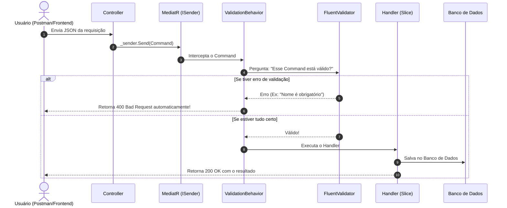

# Guia Didático: Do CRUD Tradicional à Arquitetura Moderna (Vertical Slices + CQRS + MediatR)

Se você veio do modelo clássico (**Controller -> Service gigante -> Repository -> Banco**) e se deparou com termos como **Command**, **Query**, **Handler**, **Behaviors** e **Validation**, é **totalmente normal achar complexo ou confuso no início**!

Este guia foi feito sob medida para você entender cada conceito de forma simples, visual e com analogias da vida real.

---

## 1. O Problema do CRUD com "Services" Gigantes

No modelo tradicional que a maioria aprende no início, a estrutura é assim:

```
Controller
   │
   ▼
TournamentService (Arquivo com 2.000 linhas)
   ├── CreateTournament()
   ├── AddTeam()
   ├── StartTournament()
   ├── GetById()
   ├── CancelTournament()
   └── ... + 30 outros métodos misturados
   │
   ▼
Repository / DbContext
```

### Por que esse modelo se torna um pesadelo em sistemas reais?
1. **Acoplamento gigante**: O `TournamentService` precisa receber 10 dependências no construtor (repositórios, loggers, e-mail, cache, notificações).
2. **Conflitos de equipe**: Quando 3 desenvolvedores mexem no mesmo arquivo `TournamentService.cs` ao mesmo tempo, acontecem conflitos difíceis no Git.
3. **Falta de foco**: Para entender como funciona a criação de um torneio, você precisa procurar um método no meio de 2.000 linhas de código não relacionadas.

---

## 2. A Nova Abordagem: Vertical Slice Architecture (Fatias Verticais)

Em vez de organizar o código por **"Camadas Técnicas"** (todos os services juntos, todos os repositories juntos), nós organizamos por **"Funcionalidade" (Feature / Slice)**.

Imagine uma pizza: em vez de comer primeiro só a massa, depois só o molho e depois só o queijo, você corta uma **fatia** que tem tudo junto!

Cada pasta dentro de `Features/` representa **uma única ação do sistema**:

```
Features/
├── Tournaments/
│   ├── CreateTournament/            <--- FATIA: Criar Torneio
│   │   ├── CreateTournamentCommand.cs   (O que o usuário quer fazer)
│   │   ├── CreateTournamentValidator.cs (As regras de validação dos campos)
│   │   └── CreateTournamentHandler.cs   (Quem realmente executa o trabalho)
│   │
│   ├── GetTournamentById/           <--- FATIA: Buscar Torneio por ID
│   │   ├── GetTournamentByIdQuery.cs    (Os parâmetros da busca)
│   │   └── GetTournamentByIdHandler.cs  (Quem vai no banco e devolve os dados)
```

**Benefício imediato**: Se amanhã você precisar alterar a regra de criar torneio, você abre apenas a pasta `CreateTournament/`. Nada mais no sistema é afetado!

---

## 3. Dicionário dos Termos que te Assustaram

Aqui está a tradução simples de cada termo:

### 🍝 Analogia do Restaurante

| Termo Técnico | Analogia no Restaurante | O que é de verdade no código |
| :--- | :--- | :--- |
| **Command** | **Pedido de Comida** | Uma classe simples que guarda os dados para **CRIAR ou ALTERAR** algo no sistema. |
| **Query** | **Pergunta sobre o Cardápio** | Uma classe simples que guarda os filtros para **CONSULTAR / LER** algo sem alterar o banco. |
| **Handler** | **O Cozinheiro (Chef)** | A classe que pega o pedido (Command ou Query) e **executa o trabalho**. |
| **MediatR / ISender** | **O Garçom** | O intermediário que leva o pedido da mesa (Controller) até a cozinha (Handler) sem que um precise conhecer o outro. |
| **Behaviors** | **Fiscal Sanitário / Inspetor** | Um filtro que inspeciona o pedido **antes** do cozinheiro começar a preparar (ex: validação de dados). |
| **Validator** | **A Lista de Regras do Pedido** | A classe do FluentValidation que diz: *"Nome não pode ser vazio, quantidade deve ser maior que zero"*. |

---

## 4. Por que alguns têm `Command` e outros têm `Query`? (Padrão CQRS)

**CQRS** significa *Command Query Responsibility Segregation* (Separar quem Altera de quem Consulta):

### ✍️ 1. É um **Command** quando:
- **Altera o estado do sistema** (cria, atualiza, remove, finaliza).
- Exemplos no seu projeto:
  - `CreateTournamentCommand`: Cria um torneio no banco.
  - `RecordManualResultCommand`: Registra o placar e fecha o jogo.
  - `SelectCaptainCommand`: Define o capitão de um time.

### 🔍 2. É uma **Query** quando:
- **Apenas lê/busca dados**, sem mudar nada no banco de dados.
- Exemplos no seu projeto:
  - `GetTournamentByIdQuery`: Busca um torneio pelo ID para exibir na tela.
  - `GetDraftSnapshotQuery`: Pega o estado atual da tela de escolha de jogadores.

> 💡 **Regra de Ouro**: 
> Se altera dados ➡️ **Command**.
> Se apenas consulta ➡️ **Query**.

---

## 5. Como o `Handler` funciona?

O Command ou a Query é apenas um objeto com propriedades (como uma folha de papel). Ele não tem lógica!

Quem tem a lógica é o **`Handler`**:
- Ele implementa a interface do MediatR:
  - `IRequestHandler<CreateTournamentCommand, TournamentDto>`
- Isso significa: *"Eu sei receber o pedido `CreateTournamentCommand` e devolver um `TournamentDto`"*.

Veja o exemplo de [RecordWalkoverHandler.cs](file:///c:/Users/gabri/Desktop/TournamentCreator/src/Modules/Tournaments/Tournaments.Application/Features/Matches/RecordWalkover/RecordWalkoverHandler.cs):

```csharp
// 1. O Handler diz o que sabe processar: RecordWalkoverCommand
public class RecordWalkoverHandler : IRequestHandler<RecordWalkoverCommand>
{
    private readonly IMatchSeriesRepository _matchRepository;
    private readonly IBracketProgressionService _progressionService;

    public RecordWalkoverHandler(
        IMatchSeriesRepository matchRepository,
        IBracketProgressionService progressionService)
    {
        _matchRepository = matchRepository;
        _progressionService = progressionService;
    }

    // 2. O MediatR chama esse método automaticamente quando alguém envia o Command!
    public async Task Handle(RecordWalkoverCommand request, CancellationToken cancellationToken)
    {
        // 1. Busca no banco
        var series = await _matchRepository.GetByIdAsync(request.MatchSeriesId, cancellationToken)
            ?? throw new DomainException($"Série '{request.MatchSeriesId}' não encontrada.");

        // 2. Chama a regra de negócio na entidade
        series.RecordWalkover(request.WinnerTeamId);

        // 3. Salva a alteração
        await _matchRepository.UpdateAsync(series, cancellationToken);

        // 4. Se a série foi concluída, avança no chaveamento
        await _progressionService.ProgressBracketAsync(series, cancellationToken);
    }
}
```

---

## 6. O que é o `MediatR` (`ISender`) no Controller?

No passado, seu controller precisava injetar vários services:

```csharp
// ❌ MODO ANTIGO (Acoplado)
public class MatchesController : ControllerBase
{
    private readonly IMatchService _matchService;
    private readonly IEmailService _emailService;
    private readonly IAuditService _auditService;
    ...
```

Com o MediatR, o controller **não sabe quem executa nada**. Ele só tem o garçom (`ISender`):

```csharp
// ✅ MODO MODERNO (Desacoplado)
public class MatchesController : ControllerBase
{
    private readonly ISender _sender; // Apenas o garçom!

    public MatchesController(ISender sender)
    {
        _sender = sender;
    }

    [HttpPost("{id:guid}/result/manual")]
    public async Task<IActionResult> RecordManualResult(Guid id, [FromBody] RecordManualResultRequest request)
    {
        // 1. Monta o pedido (Command)
        var cmd = new RecordManualResultCommand(id, request.WinnerTeamId, request.DurationSeconds, request.TeamAKills, request.TeamBKills);

        // 2. Entrega para o garçom e espera a resposta
        await _sender.Send(cmd);

        return Ok(new { message = "Resultado registrado com sucesso!" });
    }
}
```

Quando você chama `_sender.Send(cmd)`, o MediatR procura na aplicação quem é a classe que implementa `IRequestHandler<RecordManualResultCommand>` e entrega o comando diretamente para ela!

---

## 7. O que são `Behaviors`? (Ex: `ValidationBehavior`)

Em pequenos projetos com CRUD, você provavelmente fazia validações manuais dentro do controller ou do service:

```csharp
// ❌ MODO ANTIGO: Código sujo e repetitivo
if (string.IsNullOrEmpty(request.Name))
    return BadRequest("Nome obrigatório");
if (request.TeamCount < 2)
    return BadRequest("Mínimo de 2 times");
```

Com **Pipeline Behaviors**, a validação acontece de forma **automática e invisível** antes do Handler ser chamado!

### O Fluxo:


O [ValidationBehavior.cs](file:///c:/Users/gabri/Desktop/TournamentCreator/src/Modules/Tournaments/Tournaments.Application/Common/Behaviors/ValidationBehavior.cs) é simplesmente esse middleware inteligente do MediatR. Se você criar um `CreateTournamentValidator`, o behavior acha ele sozinho e valida antes de rodar o código do Handler!

---

## 8. Resumo: Como criar uma nova funcionalidade do zero agora?

Imagine que você quer criar uma nova funcionalidade: **"Cancelar Torneio"**:

1. **Crie a pasta**: `Features/Tournaments/CancelTournament/`
2. **Crie o Command**: `CancelTournamentCommand.cs`
   ```csharp
   public record CancelTournamentCommand(Guid TournamentId) : IRequest;
   ```
3. **Crie o Validator**: `CancelTournamentValidator.cs`
   ```csharp
   public class CancelTournamentValidator : AbstractValidator<CancelTournamentCommand>
   {
       public CancelTournamentValidator()
       {
           RuleFor(x => x.TournamentId).NotEmpty().WithMessage("ID é obrigatório.");
       }
   }
   ```
4. **Crie o Handler**: `CancelTournamentHandler.cs`
   ```csharp
   public class CancelTournamentHandler : IRequestHandler<CancelTournamentCommand>
   {
       private readonly ITournamentRepository _repo;
       public CancelTournamentHandler(ITournamentRepository repo) => _repo = repo;

       public async Task Handle(CancelTournamentCommand request, CancellationToken ct)
       {
           var tournament = await _repo.GetByIdAsync(request.TournamentId, ct);
           tournament.Cancel(); // Regra rica no domínio
           await _repo.UpdateAsync(tournament, ct);
       }
   }
   ```
5. **No Controller**, basta uma linha:
   ```csharp
   [HttpPost("{id}/cancel")]
   public async Task<IActionResult> Cancel(Guid id)
   {
       await _sender.Send(new CancelTournamentCommand(id));
       return Ok();
   }
   ```

**Pronto!** Você não precisou mexer em nenhum service gigante, não quebrou nenhum outro arquivo e tudo ficou limpo, testável e isolado.
