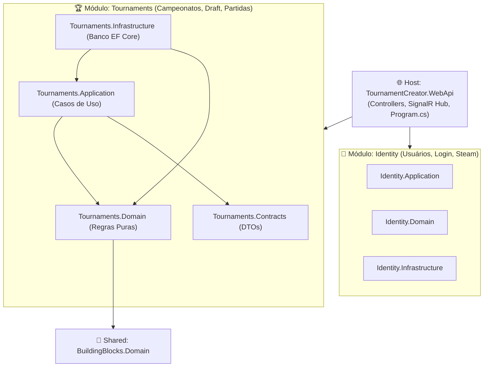
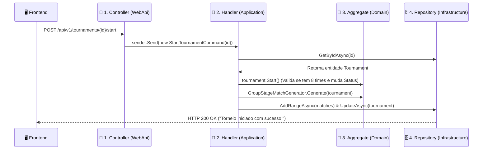

# Guia de Estudo da Arquitetura & Revisão Técnica do Backend (Tournament Creator)

Este documento foi elaborado com dois objetivos:
1. **Servir como material de estudo completo** sobre a arquitetura utilizada neste projeto, explicando cada conceito de forma clara (do nível iniciante ao avançado).
2. **Apresentar uma auditoria/validação técnica do backend atual**, destacando os pontos fortes e listando **melhorias práticas (com o "porquê" de cada uma)** para deixar o desenvolvimento e a performance ainda melhores.

---

## Parte 1: Qual é a Arquitetura deste Projeto? (Para Estudo)

O backend do **Tournament Creator** combina 4 dos padrões mais valorizados no mercado de engenharia de software moderno em **.NET / C#**:

1. **Modular Monolith (Monólito Modular)**
2. **Clean Architecture (Arquitetura Limpa / Cebola)**
3. **DDD (Domain-Driven Design — Design Guiado pelo Domínio)**
4. **CQRS + Vertical Slices (Feature-First)**

### 1.1. O que é um "Monólito Modular"?
Muitas empresas começam criando *Microsserviços* cedo demais e acabam tendo que manter 10 servidores diferentes, filas complexas e deploy lento. Por outro lado, um *Monólito Tradicional (Espaguete)* mistura código de Login, Banco de Dados e Regras de Torneio na mesma pasta, virando uma bagunça.

O **Monólito Modular** é o equilíbrio perfeito:
- **É um único servidor para rodar (`TournamentCreator.WebApi`)**: Fácil de dar *play*, fácil de debugar e barato de hospedar.
- **Mas internamente é dividido em Módulos independentes (`Modules/Identity` e `Modules/Tournaments`)**: O módulo de `Tournaments` **não sabe que existe banco de usuários, senha ou Steam**. Ele só conhece regras de campeonato e IDs genéricos. Se um dia você quiser transformar `Tournaments` em um microsserviço separado, ele já está fisicamente isolado!



---

### 1.2. Explicando as Camadas (Como se fosse uma Empresa)

Para entender rápido o papel de cada projeto dentro de `src/Modules/Tournaments`, imagine o funcionamento de uma empresa:

| Camada (Projeto) | Analogia Simples | O que fica aqui dentro? | Depende de quem? |
| :--- | :--- | :--- | :--- |
| **`Tournaments.Contracts`** | **O Cardápio / Formulário** | Apenas `records` (DTOs) que entram e saem da API (ex: `TournamentDto`, `BracketSlotDto`). Não tem lógica. | Ninguém (C# puro). |
| **`Tournaments.Domain`** | **O Juiz das Regras (Coração)** | Entidades (`Tournament`, `DraftSession`, `MatchSeries`) e cálculos puros (`SnakeDraftCalculator`, `DoubleEliminationBracketBuilder`). **Não sabe que existe banco de dados nem HTTP.** | Apenas `BuildingBlocks.Domain`. |
| **`Tournaments.Application`** | **O Maestro / Gerente** | Casos de uso organizados por funcionalidade (*Features*). Ele busca a entidade no repositório, chama a regra do Juiz (`Domain`), salva e avisa o SignalR. | `Domain` e `Contracts`. |
| **`Tournaments.Infrastructure`** | **O Encanamento / Banco** | Onde ficam o PostgreSQL, Entity Framework Core (`TournamentDbContext`), leitura de arquivos e chamadas externas. | `Application` e `Domain`. |
| **`TournamentCreator.WebApi`** | **A Recepção (Portaria)** | Recebe a chamada HTTP do Frontend (`Controllers`), valida o token JWT e entrega o pedido para a `Application` via `MediatR`. | Todas as camadas. |

---

### 1.3. O que é DDD (Domain-Driven Design) e "Modelo Rico vs. Modelo Anêmico"?

Em projetos iniciantes (chamados de **Modelo Anêmico**), as classes são apenas "sacos de propriedades" com `get; set;` públicos, e qualquer lugar do código pode mudar o status de um torneio sem querer:
```csharp
// ❌ MODELO ANÊMICO (Ruim - qualquer um pode quebrar a regra)
tournament.Status = TournamentStatus.Completed; 
tournament.ChampionId = timeQualquer;
```

Neste projeto usamos **DDD com Modelo Rico**:
- As propriedades têm `private set;` (ninguém altera de fora).
- Para alterar algo, você é obrigado a chamar um **método de negócio** na entidade, que protege a regra (chamada de *Invariante de Domínio*):
```csharp
// ✅ MODELO RICO (Usado no nosso projeto em Tournament.cs)
public void CrownChampion(Guid teamId, string teamName)
{
    if (Status != TournamentStatus.Playoffs)
        throw new DomainException("O torneio precisa estar na fase de Playoffs para coroar o campeão.");

    ChampionId = teamId;
    ChampionName = teamName;
    Status = TournamentStatus.Completed;
    Touch();
}
```

#### Por que temos 3 `AggregateRoots` (Raízes de Agregado) separados?
Em vez de colocar tudo dentro da classe `Tournament` (o que faria o banco carregar todos os jogadores do draft, todos os times e todos os 50 mapas jogados toda vez que alguém abrisse a tela), dividimos em **3 Raízes independentes**:
1. **`DraftSession`**: Cuida só do Draft ao vivo.
2. **`Tournament`**: Cuida da configuração do campeonato, grupos e estrutura das chaves (`BracketSlots`).
3. **`MatchSeries`**: Cuida de uma série (MD1, MD3, MD5) e seus jogos individuais (`MatchGame`).

---

### 1.4. Qual o Nível dessa Arquitetura? Dá para entender quem está começando?

- **Nível de Mercado:** **Pleno / Sênior (Arquitetura Corporativa / Produção)**. É exatamente esse tipo de arquitetura cobrado em testes técnicos e usado em sistemas financeiros, e-commerces de grande porte e plataformas competitivas.
- **Facilidade para Iniciantes (Nota 9/10):** Embora use conceitos avançados, ela é **muito fácil de navegar no dia a dia** porque a camada `Application` usa o padrão **Feature-First (Vertical Slices)**.

#### Por que o Feature-First ajuda quem está começando?
Em vez de você procurar arquivos espalhados em 10 pastas diferentes, **tudo o que uma funcionalidade faz fica junto na mesma pastinha**!
Quer estudar ou alterar como o "Pick de Jogador no Draft" funciona? Basta abrir uma única pasta:
- `Features/Draft/PickStarterPlayer/`
  - `PickStarterPlayerCommand.cs` (Quais dados entram)
  - `PickStarterPlayerValidator.cs` (Validação de campos vazios)
  - `PickStarterPlayerHandler.cs` (O passo a passo que busca no banco, chama o domínio e avisa o SignalR)

---

## Parte 2: Validação Geral do Backend (O que já está Excelente)

Após revisar todos os módulos, controllers, entidades e testes, aqui está o diagnóstico do que já está em altíssimo nível no projeto:

1. **Bateria de Testes Automatizados Sólida:** O projeto conta com **125 testes passando em ~1 segundo**, cobrindo desde a matemática do Snake Draft até simulação ponta a ponta de torneios de 4 a 8 times, desempates e *Rollback*.
2. **Proteção contra Clique Duplo / Concorrência (`DraftVersion`):** O uso de versionamento otimista no Draft impede que dois cliques rápidos escolham dois jogadores no mesmo turno, retornando `409 Conflict` automaticamente.
3. **Padronização de Erros (`GlobalExceptionHandler`):** O frontend nunca recebe telas de erro genéricas do C#. Qualquer regra violada (`DomainException`) ou erro de validação (`ValidationException`) vira um JSON padronizado (`ProblemDetails` RFC 9457) com status HTTP correto (`400` ou `409`).
4. **Persistência Híbrida Inteligente no PostgreSQL:** Usar colunas normais para o que precisa de filtro rápido (`WinnerTeamId`, `DurationSeconds`) e `JSONB` (`.ToJson()`) para listas internas (`PlayerStats`, `BracketSlots`, `Teams`) evita dezenas de `JOINs` lentos no banco.

---

## Parte 3: Sugestões de Melhoria e Otimização (O Que Melhorar e Por Quê)

Abaixo estão **5 melhorias reais** identificadas no código atual que vão deixar o desenvolvimento mais ágil, o código mais limpo e o servidor mais rápido:

### 🚀 1. Usar `.AsNoTracking()` nas Consultas de Leitura (Queries)
- **Onde está hoje:** Nos repositórios (`EfTournamentRepository.cs`, `EfMatchSeriesRepository.cs`, `EfDraftSessionRepository.cs`), métodos como `GetAllAsync` e `GetByTournamentIdAsync` fazem consultas sem `.AsNoTracking()`.
- **Por que melhorar:** Por padrão, toda vez que o Entity Framework busca dados do banco, ele tira uma "foto" (snapshot) de cada objeto na memória RAM para saber se você vai alterá-lo depois (*Change Tracking*). Porém, em rotas `GET` (como listar torneios, ver chaves ou buscar o snapshot do Draft), nós **só queremos ler e devolver o DTO para o front**.
- **Ganho:** Adicionar `.AsNoTracking()` nas queries de leitura reduz o uso de memória RAM e deixa as respostas de `GET` **30% a 40% mais rápidas**.

### 🔒 2. Unificar o `SaveChangesAsync()` (Padrão *Unit of Work*) em Operações Múltiplas
- **Onde está hoje:** Cada método do repositório (`AddAsync`, `UpdateAsync`) chama `_dbContext.SaveChangesAsync()` imediatamente lá dentro.
- **Qual é o problema:** Veja o `BracketProgressionService.cs` (linhas 68 e 92) ou o `CompleteDraftHandler.cs` (linhas 31 e 44):
  1. Ele salva o `DraftSession` no banco (`SaveChangesAsync` #1).
  2. Depois ele salva o `Tournament` no banco (`SaveChangesAsync` #2).
  - **Por que melhorar:** Se acontecer qualquer erro no passo 2 (ex: nome de time duplicado ou queda de rede), o passo 1 **já foi salvo no banco** e não volta atrás, deixando o Draft como `Completed`, mas o Torneio sem os times! Além disso, você vai ao banco de dados 2 ou 3 vezes na mesma requisição em vez de 1 só.
- **Como resolver:** Salvar todas as alterações no final do Handler em uma única transação atômica (`UnitOfWork.CommitAsync()`).

### 📡 3. Notificações em Tempo Real (SignalR) para Partidas e Chaves
- **Onde está hoje:** O `Draft` tem o `ITournamentRealtimeNotifier` que avisa todos os usuários conectados a cada clique. Porém, os handlers de partidas (`RecordReplayResultHandler`, `RecordWalkoverHandler`, `AdvanceToPlayoffsHandler`) salvam no banco e **não emitem evento no SignalR**.
- **Por que melhorar:** Enquanto os jogadores estão com a tela da chave aberta esperando o resultado de um jogo, hoje eles precisam atualizar a página (F5) ou fazer *polling* para ver que o time avançou para a Semifinal.
- **Ganho:** Disparar um evento `TournamentUpdated` / `MatchUpdated` no SignalR assim que uma partida acaba fará a chave do campeonato se mover "sozinha" ao vivo na tela de todos os espectadores!

### 🧹 4. Remover o uso de `Reflection` na criação do Torneio com Draft
- **Onde está hoje:** No arquivo `CreateTournamentHandler.cs` (linhas 46 a 60):
  ```csharp
  var tempTournamentId = Guid.NewGuid();
  var draftSession = new DraftSession(tempTournamentId, request.TeamCount);
  // ... cria o torneio e depois cria OUTRA DraftSession usando Reflection para forçar o Id:
  typeof(DraftSession).GetProperty("Id")?.SetValue(finalDraftSession, draftSessionId.Value);
  ```
- **Por que melhorar:** Usar `Reflection` (`GetProperty("Id")?.SetValue(...)`) quebra o encapsulamento do DDD, é mais lento e se alguém renomear a propriedade `Id` no futuro, o compilador não avisa e o código quebra em tempo de execução.
- **Como resolver de forma limpa:** Basta criar o `Tournament` primeiro (ele já gera o `tournament.Id`), depois criar uma única `new DraftSession(tournament.Id, request.TeamCount)` e chamar um método simples `tournament.LinkDraftSession(draftSession.Id)`. Zero *Reflection* e metade das linhas de código!

### 🗄️ 5. Migrar o SQL manual do `Program.cs` para Migrations do EF Core
- **Onde está hoje:** No `Program.cs` (linhas 110 a 163), existem blocos de `ExecuteSqlRaw("ALTER TABLE ... ADD COLUMN IF NOT EXISTS ...")` que rodam toda vez que a API liga.
- **Por que melhorar:** Colocar `ALTER TABLE` direto no `Program.cs` foi ótimo para agilizar o início do projeto sem precisar rodar comandos no terminal, mas conforme o projeto cresce, o `Program.cs` vai ficando gigante e poluído com código SQL.
- **Ganho:** Usar as *Migrations* nativas do EF Core (`dotnet ef migrations add`) e `dbContext.Database.Migrate()` mantém o `Program.cs` limpo com apenas 1 linha e guarda todo o histórico de evolução das tabelas organizado na pasta `Infrastructure/Persistence/Migrations`.

---

## Resumo Final: Roteiro Rápido de Estudo do Fluxo de uma Requisição

Sempre que você quiser estudar qualquer funcionalidade do backend, siga esta **linha reta de 4 passos**:



1. **Porta de Entrada (`Controllers/v1/`):** Veja qual `Command` ou `Query` o endpoint envia no `_sender.Send(...)`.
2. **Validação de Entrada (`Features/.../*Validator.cs`):** Veja quais regras básicas de formulário o `FluentValidation` exige antes mesmo de ir ao banco.
3. **Orquestração (`Features/.../*Handler.cs`):** Veja como o Handler busca os dados no repositório e quais métodos ele chama.
4. **Regra de Negócio Pura (`Tournaments.Domain/Entities/`):** Veja dentro da entidade como ela valida se a ação é permitida e como altera seu estado.

